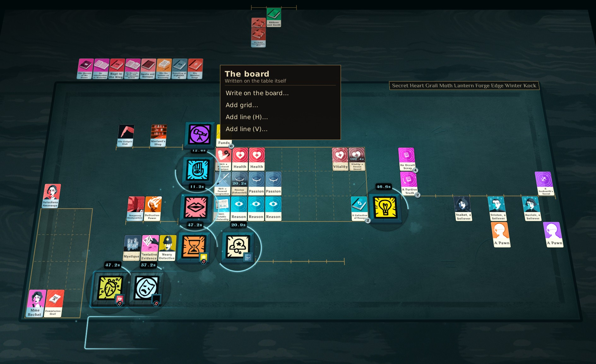
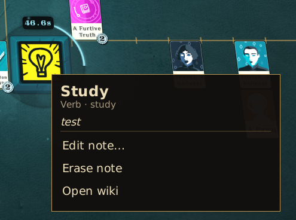
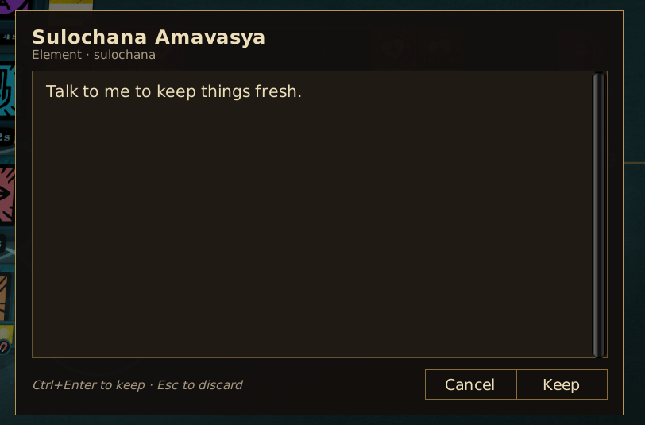
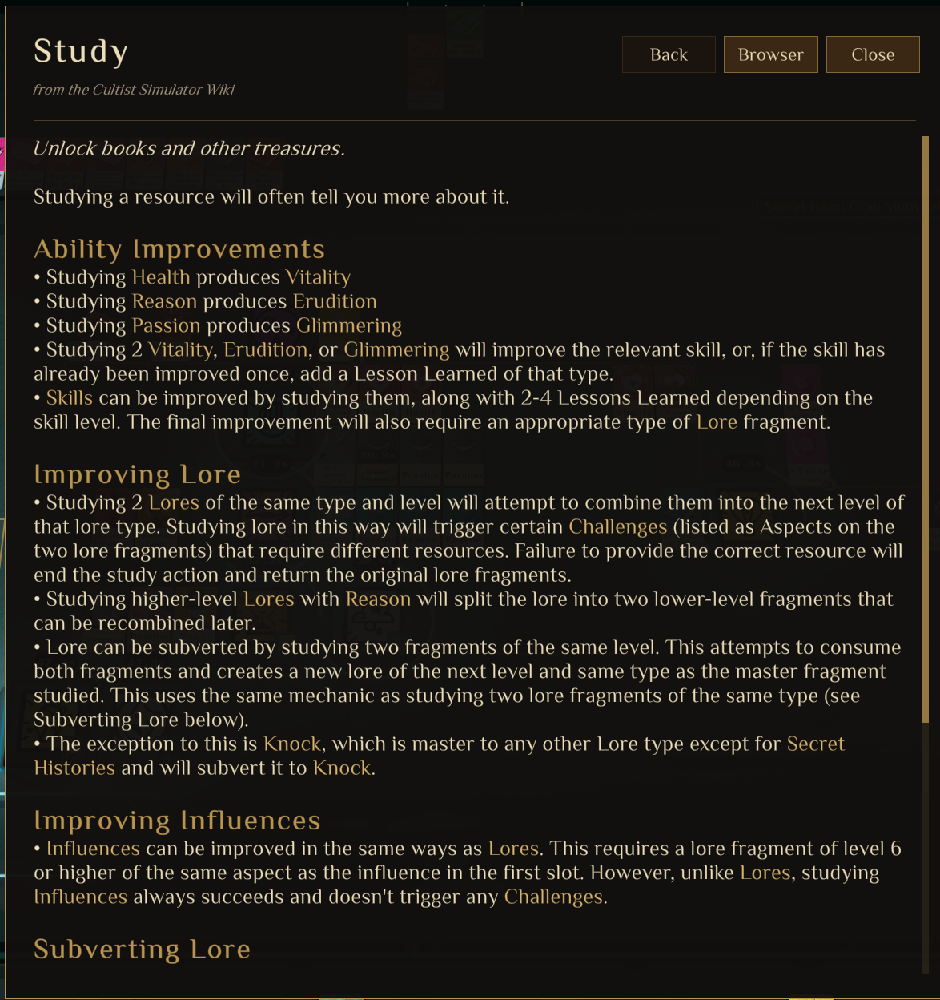
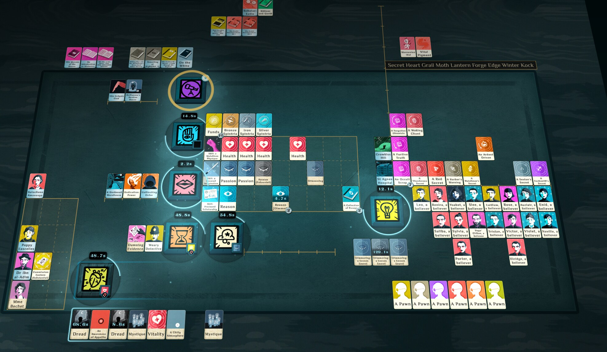
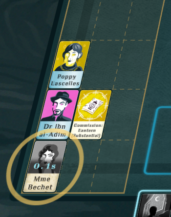
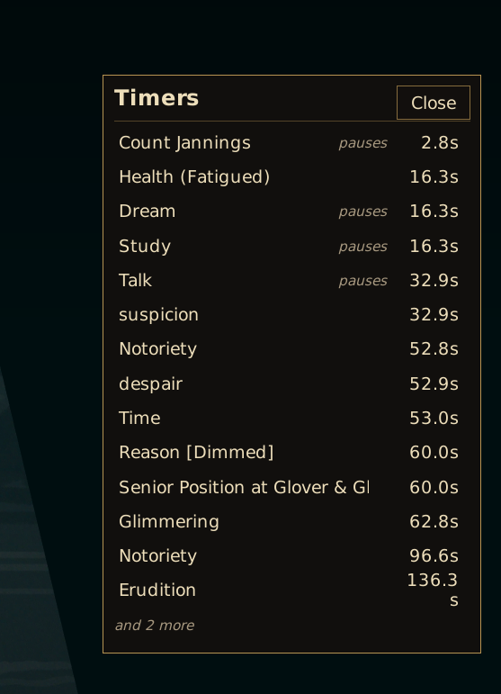
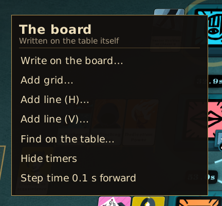

**NOTE**: This repository is entirely AI generated. This note is the only human authored line. This is a basic mod for myself, because I got tired of messy notes, and I put next to no effort in creating it.

# Marginalia

A [Cultist Simulator](https://store.steampowered.com/app/718670/Cultist_Simulator/) DLL mod that adds a hidden context menu to cards, verbs, aspects and the board. You can attach a persistent note to any card, verb or aspect, write labels directly on the table, and draw rulers (card-sized grids and lines) to lay cards out by hand. It can also show the community wiki's article for any card, aspect or verb in an in-game window. And it can pause the game the moment a verb finishes, or just before a card decays.

This is an unofficial fan mod. It isn't affiliated with Weather Factory or Fandom. It has only been tried on Linux (Steam), with game version 2026.1.g.2.



| A note on a verb | Writing a note | The wiki, in game |
| --- | --- | --- |
|  |  |  |

## Use

- **Middle-click** a card, a verb, an aspect icon, an open verb, card or aspect window, or the table to open the menu. **Alt + right-click** does the same.
- Or rest the pointer on a card or verb for a moment: a small round **…** button appears in its top-left corner. Click it for the menu.
- Or **double-click** an aspect icon.
- Pick **Write note…** or **Edit note…**. **Enter** starts a new line. Press **Ctrl+Enter** to save the note (the button is labelled *Keep*) or **Esc** to discard it. **Erase note** deletes it.
- If a note exists, the menu shows a preview of it.
- **Open wiki** shows the item's [Cultist Simulator Wiki](https://cultistsimulator.fandom.com/) article in an in-game window, so it doesn't depend on Steam or a browser. The mod uses the wiki's API to find the best-matching title, fetch the article, and convert it to the game's text format. Links between articles work inside the window. Use **Back** (or the mouse back button) to return, and **Close**, **Esc** or a click outside to dismiss it. **Browser** opens the same article in the Steam overlay, or your system browser if the overlay is unavailable. Fandom's bare `?action=render` view keeps that fast. Images aren't shown, and very long articles are cut short with a pointer to the browser.

Pausing:

| A verb has finished | A card is about to decay |
| --- | --- |
|  |  |

- On a card that decays, pick **Pause before it decays…**. It applies to every card of that kind.
- On a verb, pick **Pause at every step…** to pause each time its timer runs out, including when its recipe leads straight into another.
- Both open a slider for how long before the timer runs out to pause, from **0 s** (right after it ends or decays) up to **185 s**. The steps are fine near zero and get coarser further out: tenths of a second at first, then whole seconds, then 25 s near the top. It opens on the current setting, or on 0.1 s for a card and 0 s for a verb. **Enter** keeps it. Pick the item again to change it, or pick **Stop pausing**.
- **Pause at the end** on a verb pauses right after a recipe that nothing follows, so the results are waiting. It has no slider: whether another recipe follows is only settled once one ends. Pick **Stop pausing at the end** to turn it off. A verb pauses either at every step or at the end, not both.
- If a timer starts with less time than the slider's setting, the game pauses as soon as it appears.
- On any card, pick **Pause when one appears** to pause every time a new card of that kind turns up: on the table, in a verb or along the bottom of the screen, including a stack growing (another *Funds*). The new card gets the ring. **Stop pausing when one appears** turns it off. It doesn't fire for cards already there when a game loads.
- The pause lands on the exact moment at any game speed. Everything else on the table has spent exactly as much time as the verb or card, no more.
- A gold ring pulses around whatever caused the pause until you unpause. If it's a card inside a closed verb window, the ring goes around the verb.
- **Step time 0.1 s forward** on the board menu pauses the game if needed, then moves it on by a tenth of a second. The menu stays open, so you can click it repeatedly. It still stops at any of the marks above.

Finding things and keeping an eye on timers:

| The timers panel | The board menu |
| --- | --- |
|  |  |

- **Find on the table…** on the board menu opens a search box. As you type, a gold ring goes around every card and verb whose name contains what you typed. A card inside a closed verb rings the verb. **Enter** closes the box and leaves the rings for a few seconds; **Esc** clears them.
- **Show timers** on the board menu opens a small panel listing every running verb and decaying card, soonest first, with the time left. Rows that will pause the game say *pauses*. Click a row to ring that card or verb. Drag the panel by its title; **Close** or **Hide timers** puts it away. It shows the 14 soonest.

On the board:

- **Alt + right-click** empty table, then pick **Write on the board…**. The text appears where you clicked, under the cards, and moves with the table when you pan and zoom.
- **Alt + right-click** a label to **Edit**, make it **Larger** or **Smaller** (the menu stays open so you can click repeatedly), or **Rub out** (delete) it.
- **Middle-drag** or **Alt + left-drag** a label to move it.

Rulers, for laying cards out by hand:

- **Alt + right-click** the table and pick **Add grid…**, **Add line (H)…** or **Add line (V)…**. Sliders set the grid's width and height in cards, or the line's length in card widths (H) or card heights (V). The ruler updates as you drag the sliders. **Enter** keeps it and **Esc** cancels.
- A grid is a frame split into card-sized cells by dashed lines. A line has a tick at every card width or height.
- Rulers snap so their cells line up with where the game snaps cards, using the grid snap setting in the game's options.
- **Alt + right-click** a ruler to **Resize** or **Remove** it. Everything else on the board menu works inside a grid too. **Middle-drag** or **Alt + left-drag** a ruler to move it.
- Rulers never move or sort cards. They are only guides drawn beneath the cards and labels.

While Alt is held, the game doesn't see your clicks, so Alt + right-click never sends a card to a verb or toggles a window. A middle-click that opens the menu doesn't reach the game either. Game hotkeys are off while the menu, editor or wiki window is open.

Notes are global: they are keyed by element or verb id and shared across all saves. Cards and aspects are both elements, so a note on the *Lantern* aspect is the same note wherever Lantern appears. Board labels and rulers are also global: they appear in every game.

Pausing choices are global too, keyed by verb or element id like notes.

Notes are stored in `marginalia.json`, board labels in `marginalia_board.json`, rulers in `marginalia_rulers.json` and pausing choices in `marginalia_pauses.json`, all in the game's save folder:

| OS | Save folder |
| --- | --- |
| Linux | `~/.config/unity3d/Weather Factory/Cultist Simulator/` |
| Windows | `%USERPROFILE%\AppData\LocalLow\Weather Factory\Cultist Simulator\` |
| macOS | `~/Library/Application Support/Weather Factory/Cultist Simulator/` |

On Steam, the mod also keeps a copy of all four files in the game's Steam Cloud space, as one small file (`marginalia_cloud.json`), so they follow you between computers like your saves do. When the game starts, each file is compared with its cloud copy and the newer one wins. If you change notes on two computers without the game syncing in between, the later change is kept. Without Steam, or with Steam Cloud turned off, everything stays local.

If one of these files can't be read, for example after a hand edit with a typo, the mod leaves it untouched and doesn't save changes to it until it's fixed. The game's log says which file it was.

The wiki window needs an internet connection. Notes and labels don't.

Settings go in `config.ini` in the save folder, one per line. For example:

```
marginalia_modifier=ctrl
marginalia_button=forward
marginalia_handle=off
```

- `marginalia_modifier` is the key held for right-click and left-drag: `alt` (the default), `ctrl` or `shift`.
- `marginalia_button` is the mouse button that opens the menu on its own: `middle` (the default), `forward`, `back` or `none`.
- `marginalia_handle=off` hides the **…** button on hovered cards and verbs.

Some Linux window managers grab Alt + right-drag. If the menu never appears, try `ctrl`.

## Build and install

The easiest way to get it is to subscribe on the [Steam Workshop](https://steamcommunity.com/sharedfiles/filedetails/?id=3829272802), along with [GHIRBI](https://steamcommunity.com/sharedfiles/filedetails/?id=2901287611). To build it yourself instead:

No prebuilt DLL is checked in, so you need to build it. This requires the [.NET SDK](https://dotnet.microsoft.com/download). The project targets net472 and compiles against the game's own assemblies, so the game must be installed.

On Linux, `install.sh` builds the mod and copies it into the local mods folder:

```sh
./install.sh
GAME_DIR=/path/to/Cultist\ Simulator MODS_DIR=/path/to/mods ./install.sh   # non-default locations
```

Elsewhere, build it yourself and copy the files:

```sh
dotnet build src/Marginalia.csproj -c Release -p:GameDir="/path/to/Cultist Simulator"
```

Then put these files in `<save folder>/mods/Marginalia/`:

```
Marginalia/
├── synopsis.json        (from mod/)
├── cover.png            (from mod/)
└── dll/
    └── Marginalia.dll   (from src/bin/Release/)
```

Finally, enable **Marginalia** in the game's Mods menu and restart the game, because DLLs load only at startup. You also need the workshop mod [GHIRBI](https://steamcommunity.com/sharedfiles/filedetails/?id=2901287611) enabled, because the game requires it before it will run any DLL mod.

## Adding menu items

Each menu entry is a `ContextMenuItem` registered with `ContextMenuRegistry`. See `NoteMenuItems` in `src/ContextMenuRegistry.cs` for an example:

```csharp
ContextMenuRegistry.Register(new ContextMenuItem
{
    Id = "example.copy-id",
    Order = 20,
    Label = t => "Copy id",
    IsVisible = t => t.Kind == TargetKind.Element,
    Execute = t => GUIUtility.systemCopyBuffer = t.Id
});
```

## Layout

| File | Purpose |
| --- | --- |
| `src/Marginalia.cs` | Entry point (`Marginalia.Initialise`) that the game's mod loader calls |
| `src/MarginaliaController.cs` | Input shield, hotkey suppression, IMGUI menu and editor, label dragging |
| `src/TargetResolver.cs` | Works out which card, verb, aspect, board label or board spot is under the pointer |
| `src/MenuTarget.cs` | The thing a menu was opened on |
| `src/ContextMenuRegistry.cs` | Menu item registry and the note items |
| `src/NoteStore.cs` | Reads and writes `marginalia.json` |
| `src/BoardLabels.cs` | Board labels: storage, tabletop TextMeshPro views, and their menu items |
| `src/Rulers.cs` | Rulers (grids and lines): storage, snapping, drawing, and their menu items |
| `src/JsonFile.cs` | Atomic JSON writes |
| `src/Wiki.cs` | Wiki API client: title lookup, article fetch and cache, browser fallback, and the *Open wiki* menu item |
| `src/WikiHtml.cs` | Converts article HTML into TextMeshPro rich text with clickable links |
| `src/WikiWindow.cs` | The in-game wiki reader (uGUI on the shield canvas) |
| `src/UiKit.cs` | Shared font, nine-sliced panels and layout helpers for the uGUI parts |
| `src/Styles.cs` | IMGUI look |
| `mod/synopsis.json` | Mod metadata |
| `mod/cover.png` | 100×100 mod cover, generated by `tools/make_cover.py` |
| `install.sh` | Builds the mod and installs it locally (Linux paths by default) |
